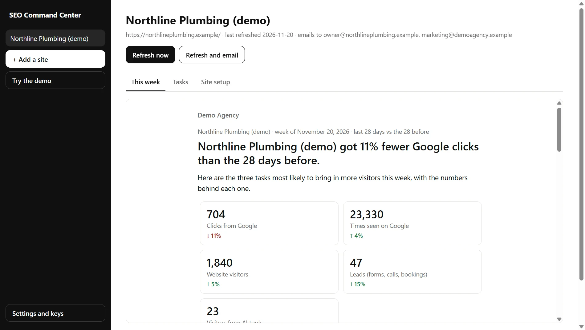
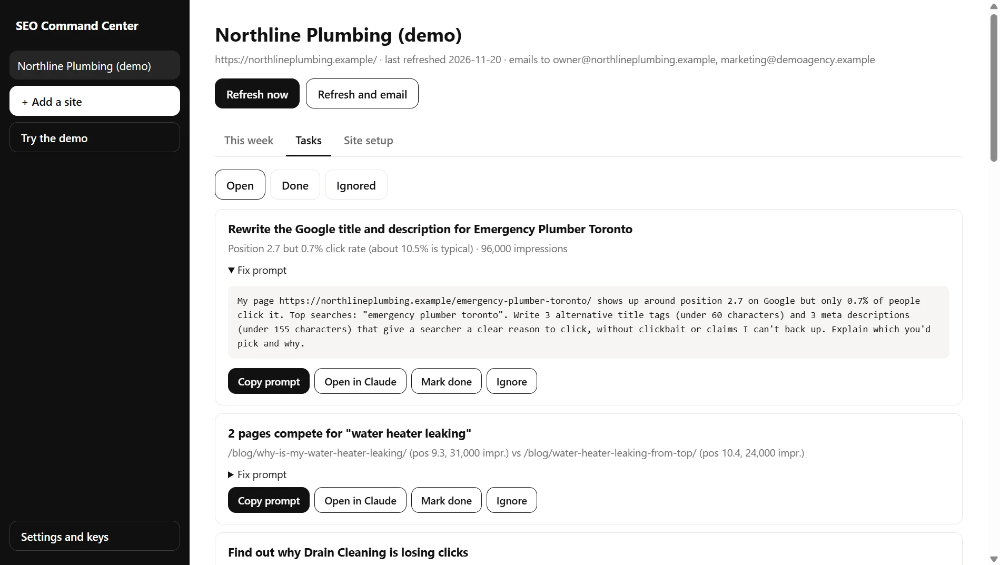
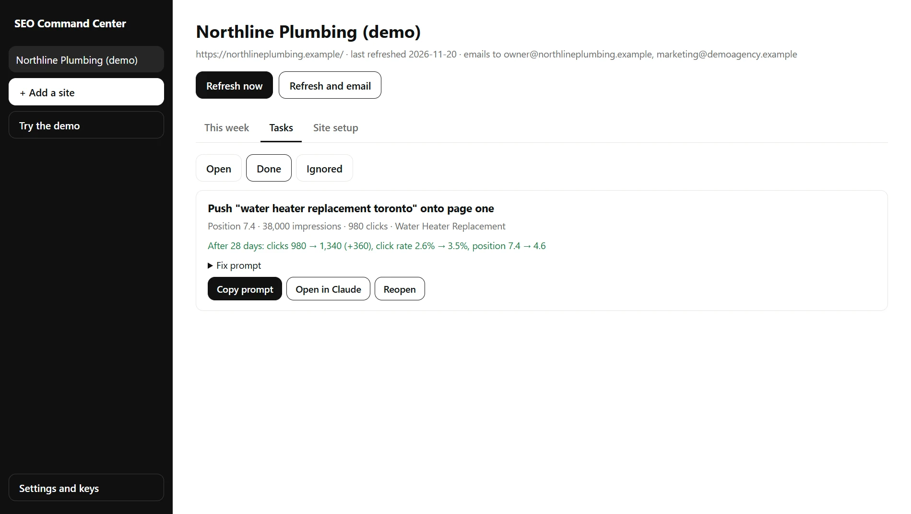
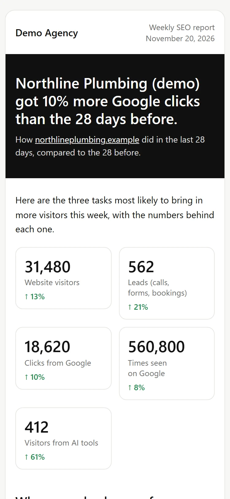

# Claude GSC SEO Command Center

A free SEO command center for small business websites. It reads Google Search Console (plus GA4 or Fathom, and PageSpeed Insights), finds what's worth fixing, and every Monday morning emails you, your team or your client the **three fixes most likely to bring in more visitors**. Each fix comes with a ready-made prompt for Claude.

It runs on your own computer. Your data stays there.

> Part of a free series by [Jef van de Graaf](https://jefvandegraaf.com): [build your site with Claude](https://github.com/jefvandegraaf/claude-code-smb-website-starter-kit) → [check it before and after launch](https://github.com/jefvandegraaf/ai-built-website-checklist) → **grow it, week by week (this repo)**.



*Screenshots use the built-in demo: a fictional plumber with made-up numbers.*

---

## What it does every week

1. **Pulls your numbers** for the last 28 days vs the 28 before: Search Console clicks, impressions, positions and searches; visitors and leads from GA4 or Fathom; visits from AI tools (ChatGPT, Perplexity, Copilot, Gemini…); mobile speed from PageSpeed Insights; index status from URL Inspection.
2. **Finds what's worth fixing**, with the numbers behind every finding:
   - **Striking distance:** searches where you sit on page one or two (positions 5–20) with real demand
   - **Titles that underperform:** pages that rank well but get far fewer clicks than that position usually earns
   - **Cannibalisation:** two of your pages competing for the same search
   - **Decay:** pages losing clicks, or dropping out completely
   - **90-day dead pages:** pages Google hasn't shown once in 90 days (pages younger than 90 days get more time first)
   - **Not indexed:** pages Google knows about but won't show
   - **Slow on phones:** PageSpeed under 50, with the biggest wins
3. **Turns findings into tasks** you can mark *done* or *ignore*, so next week's email moves on. 28 days after you mark one done, it measures what changed ("clicks 31 → 58, position 7.4 → 4.9").
4. **Emails a digest** via Resend: a one-line summary, your numbers, this week's three tasks, each with a fix prompt you can open straight in Claude or paste into Claude Code in your website's folder.

<table><tr>
<td width="62%"><br></td>
<td width="38%"></td>
</tr></table>

Optional: let **Claude** pick and explain the week's top three (your own Claude API key, or Claude Code on your own computer). It only ranks and explains findings the rules already made, with their numbers. It can't invent new ones.

## For business owners, and for freelancers and agencies

- **In-house:** one site, emails to you and your marketer.
- **Freelancers and agencies, steal this:** add every client site, one Google service account for all of them, your name, logo and colour on each client's email, your reply-to address, and the credit line switched off if you like. The demo mode (made-up data) is handy on sales calls. See [docs/agencies.md](docs/agencies.md).

## Quickstart

Needs [Node.js](https://nodejs.org) 20 or newer.

```
git clone https://github.com/jefvandegraaf/claude-gsc-seo-command-center.git
cd claude-gsc-seo-command-center
npm install
npm run app
```

Click **Try the demo** to see a full week with made-up data. No keys needed.

Then, in **Settings and keys**:

1. **Google:** create a service account and add its email to your Search Console property (and GA4, if you use it). [docs/setup-google.md](docs/setup-google.md) walks you through it in about 10 minutes. Choose the key file in the app.
2. **Resend** (for the email): a free account, a verified sending domain, and an API key. Set your "Send from" address.
3. **Optional:** Fathom API token, PageSpeed Insights API key, Claude API key.

Add your site, click **Refresh now**, read the week, then add the people who should get the Monday email.

Prefer the command line? Everything works there too. Run `node cli.mjs` to see the commands, and see [.env.example](.env.example) for the environment variables.

If `npm run app` says Electron failed to install, run `node node_modules/electron/install.js` once.

## When do emails go out?

The app sends the Monday email while it's open, including minimised to the tray (it can start when you log in). If your computer was off on Monday, it catches up the next time it's open that week.

Need emails while your computer sleeps, or for a whole agency client list? [docs/always-on.md](docs/always-on.md) shows how to run it from Windows Task Scheduler, macOS launchd, cron or a small always-on server.

## Privacy and security

- Read-only access: Search Console and GA4 read-only scopes, Fathom read-only.
- Keys are encrypted with your operating system's keychain (desktop app) or read from environment variables (command line). They're never written to this folder, never shown again after you save them, and only sent to the service they belong to.
- Data (snapshots, tasks, digests) lives in your user data folder, not in this repo: `%APPDATA%\seo-command-center` on Windows, `~/Library/Application Support/seo-command-center` on macOS, `~/.config/seo-command-center` on Linux.
- Searches containing anything on a site's "never show" list (a private person's name, for example) are dropped before analysis.
- If you turn on Claude summaries, only the site name, your numbers and the findings are sent to Claude. No visitor data.

## How it decides

Rules, not vibes. The thresholds scale with your site's size, so a small local site still gets useful findings. Search Console data runs about three days behind, so each week covers the 28 days ending three days ago. Everything is in [src/analyse.mjs](src/analyse.mjs) if you want to tune it.

## Rather have someone do it?

I'm Jef van de Graaf. I run this for my own site and for clients, and I'll fix what it finds if you don't have the time. [Get in touch](https://jefvandegraaf.com/contact/).

## License

Code: [MIT](LICENSE). Docs, prompts and the finding explanations: [CC BY 4.0](https://creativecommons.org/licenses/by/4.0/), credit **Jef van de Graaf** with a link to https://jefvandegraaf.com/ai-website-launch-checklist/
